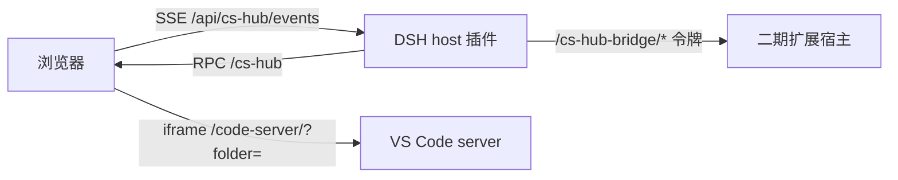

# dsh-worktree-editor

给 [DeepSeek Harness](https://github.com/deepseek-ai) 用的编辑器插件：**每个会话一个 VS Code 窗口**，
窗口根目录自动跟随该会话的 worktree；右侧栏一个页签，切会话不串台，切 worktree 只重载该窗。

> 本仓是**发布镜像**（源在内部 monorepo）。Issue / PR 欢迎，但 PR 会被 cherry-pick 回上游后重建镜像。

## 特性

- **每会话独立窗口**：iframe 钉住 `?folder=<会话 worktree>`，两会话并排互不影响。
- **根跟随**：会话 `working-directory/change` / `worktree-root/changed` → 只让该会话的 iframe 重载。
- **LRU 冻结**：最多同时 live N 个窗口（默认 3），超限冻结最旧（活动会话豁免）；冻结窗显示「已冻结·点击恢复」，iframe 卸载、extHost 退出。
- **同源继承**：走 DSH 自己的 `/code-server/` 挂载，复用 DSH 的登录/Origin/Host 防护。
- **与自带预览共存**：markdown/html/图片/PDF 仍归 DSH 自带预览，不进编辑器。
- **bridge 通道**（一期无消费方）：`/cs-hub-bridge/*` 自带令牌鉴权，供二期 VS Code 扩展上报 diff/锁/跟随。

## 架构



细节见 [docs/ARCHITECTURE.md](docs/ARCHITECTURE.md)。

## 前置要求

- DeepSeek Harness `0.2.1-rc.2`（web profile）。
- Node ≥ 22（安装脚本与本插件都用 ESM）。
- Windows 需要给 `dsh-code-server-app` 打一个补丁（命名管道 extHost 缺陷），见下文。
- 编辑器本身的扩展（主题/语言/Java/Go）可选装。

## 快速安装

```bash
# 1. 装服务层（固定 0.3.75）+ 打补丁 + 写设置 + 装 minimal 扩展（主题/图标）
node scripts/install.mjs

# 2. 只检查、不改动（退出码 5 = 有待做项）
node scripts/install.mjs --check

# 3. 分步执行
node scripts/install.mjs --service --registry=https://registry.npmmirror.com
node scripts/install.mjs --patch
node scripts/install.mjs --settings
node scripts/install.mjs --extensions=langs   # minimal|langs|all|none
```

安装脚本做的事：服务层版本校验 → Windows 补丁（非 win32 自动跳过）→ `settings.json` 幂等合并（写前 `.bak`）→
按集合装扩展（Open VSX 主、官方市场兜底）→ 输出验证步骤。**全程幂等，可重复跑。**

## 服务层与 Windows 补丁

`dsh-code-server-app` 在 `serve: dsh`（命名管道）模式下，Windows 上 extHost 会报
`write ENOTSUP`——原因是 Node/libuv 不能把管道句柄 `child.send()` 给子进程。
`patches/dsh-code-server-app-0.3.75-win-exthost.mjs` 给它加了 `socket-path` 注入（8 行改动），
脚本自带版本守卫，`--verify` / `--revert` 可用；**升级包版本后要重跑**。

## 配置

profile 的 `cordis.patch.yml` 里 `- id: code-server` 一行：

| 字段 | 默认 | 说明 |
|---|---|---|
| `maxLiveWindows` | 3 | 同时 live 的窗口数（1–6）；超限冻结最旧 |
| `serverMount` | `/code-server/` | 服务层挂载前缀（改这里要同步服务层） |
| `allowLoopback` | false | 一期未生效（跨源直连分支留二期） |
| `bridgeEnabled` | true | `/cs-hub-bridge/*` 令牌通道开关 |

```yaml
- override:
    - id: code-server
      config:
        serve: dsh
        keepResident: false
        locale: zh-cn
```

## 使用

1. 打开右侧栏 → 「编辑器」页签 → 该会话的 VS Code 窗口。
2. 切会话：页签跟着会话走；切 worktree：**只重载该会话**的 iframe。
3. 开第 N+1 个窗口超过上限：最旧窗口显示「已冻结·点击恢复」，点恢复才重建 iframe。
4. 两个会话同 folder：bridge 反查归属最新显式注册者，另一个显示提示条（不互踢）。

## 可选扩展 / 主题 / 中文

- `--extensions=minimal` 装 Dracula 主题 + Material 图标，`settings.json` 会写入 `workbench.colorTheme="Dracula Theme"`。
- **中文界面**：语言包装上后，首次需在 IDE 内装一次以生成 `<user-data>/languagepacks.json`：
  `Ctrl+Shift+P` → `Extensions: Install from VSIX...`（远端文件选择器填 VSIX 路径）→ Install → reload。
  脚本不会替你生成该文件（那是扩展管理服务的内部流程）。
- Java 需要 **JDK 25+** 给 jdt.ls 用；Go 需要 `gopls`（`go install golang.org/x/tools/gopls@latest`）。
  loose 单文件没有项目（`pom.xml`/`go.mod`）时语言服务是轻量模式，跳转能力有限——把项目放进会话 worktree 才有全功能。

## 与 dsh-portable 同步 / restore 钩子

- 同步的是：源码、`patches/`、`scripts/`；**不同步**：`bridge.json`、`extensions.json`、`user-data/`、本机路径。
- `restore.ps1` 恢复完插件后若发现 `scripts/post-restore.mjs`，会调用它（重打补丁 + 装 minimal 扩展 + JDK 探测写设置），
  失败只告警不中断恢复：

```bash
node scripts/post-restore.mjs --dsh-home "$env:USERPROFILE/.dsh" --profile web
```

## 故障排查

见 [docs/TROUBLESHOOTING.md](docs/TROUBLESHOOTING.md)。最常见三条：

- `healthz` 401/502 / iframe 空白 → 服务层没起或 elect 失败；看 `~/.dsh/code-server/user-data/logs/<最新>/`。
- 编辑器里打不了字/卡住 → 看 `pid.json` 不可信（stale），重启用 `POST /api/code-server/stop|start`。
- extHost 反复退出 → 补丁没打或包版本变了，重跑 `node patches/…win-exthost.mjs --verify`。

## 安全

- bridge 令牌只保护本机扩展侧路由；令牌文件落盘收紧 ACL（POSIX 0600 / Windows 仅当前用户 R,W）。
- `/cs-hub-bridge/*`：未认证请求**不读请求体**直接 401；带 `Origin` 一律 403。
- 威胁模型不含「同机同用户进程」。

## 开发

```bash
node --check index.js client.js lib/*.js
node --test            # 84 个用例，0 skip
node scripts/publish-open-source.mjs --dry-run   # 生成发布清单并做脱敏断言
```

客户端产物是**手写的 `__ModuleLoader__` 工厂**（`client.js`，无构建步骤）；纯函数挂在 `module.exports.__test` 供单测。

## 许可与致谢

MIT © 2026 InkReturn。致谢 code-server、VS Code、`dsh-code-server-app`（各自许可见其发行物）。
