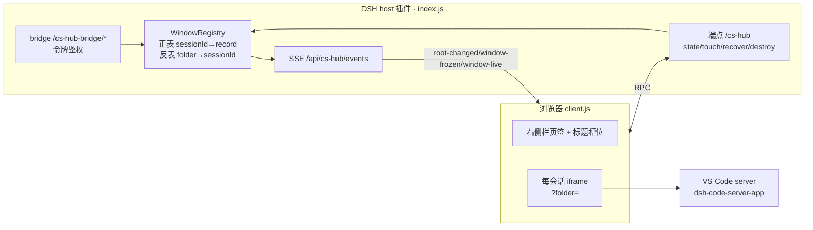

# 架构说明

本插件把 VS Code server 作为「每会话一个窗口」嵌进 DSH 右侧栏。三块组成：

## 1. 根解析（lib/root.js）

优先级：`worktreeRoot` → `workingDirectory.get(session)` → `session.header.cwd`（降级并标记 uncertain）。
不确定相（切换 worktree 的中间态）fail-closed：不注册、不渲染 iframe，UI 显示 ⚠。

## 2. 窗口注册表（lib/registry.js）

- 正表 `sessionId → {folder, realFolder, state: live|frozen, lastActiveAt, revision, stale}`；
- 反表 `pathKey(realFolder) → sessionId`（Windows 小写），供 bridge 反查；
- `register(sessionId, view, {preserveFrozen})`：新会话注册 live；`preserveFrozen` 时已冻结记录**保持冻结**只更新 folder/revision；
- 只有 `window.recover` 能把 frozen 置回 live；
- 同 folder 冲突：后注册者胜出，旧记录标 `stale` 并广播 `registry-conflict`（**客户端只提示、不重拉**，否则会 A/B 互踢成环）。

## 3. RPC 端点（lib/endpoints.js）

| 端点 | 语义 |
|---|---|
| `state` | 已有记录**只读返回**（不接管、不改 frozen）；仅全新 sessionId 才懒注册。返回 `root/window/windows/server/limits/frameFolder` |
| `window.touch` | 刷 `lastActiveAt`，不改 frozen/live |
| `window.recover` | **唯一** frozen→live 入口；置 live 后压 LRU，广播 `window-live` |
| `window.destroy` | 移出正表 + 条件摘除反表（幂等） |

## 4. SSE 事件（契约 §4.3，6 种）

`root-changed{sessionId,root,realRoot,kind,branch,phase,frozen}`、
`window-frozen{sessionId,folder,reason}`、`window-live{sessionId,folder}`、
`registry-conflict{sessionId,folder,takenBy}`、`bridge-event{sessionId,type,payload}`、`server-status{...}`。

客户端约定：`root-changed` 总是重拉一次（只读 state，安全）；`window-frozen` 只置本地冻结标记、**不重拉**；
`window-live` 清标记并重拉；`registry-conflict` 只记提示、不重拉。

## 5. 客户端（client.js）

手写 `window.__ModuleLoader__` 工厂（无构建）：注册右侧栏 tab 类型（`multiple:false`、`keepMounted:true`）+
正文/标题两个 keyed 槽位；正文按 `decideViewState({state, probe, loading, frozen})` 分六支渲染：
loading / error / uncertain / unavailable / frozen（占位，不建 iframe）/ frame（iframe）。

## 6. 安全边界

- `/api/*` 走 DSH 的 cookie fence；`/cs-hub-bridge/*` 移出 `/api`（扩展宿主是 Node 进程，拿不到 cookie），改用令牌；
- bridge 请求顺序：前缀 → Origin(403) → health → 白名单 → 令牌(401) → 方法(405) → 体；
  **未认证请求不读请求体**；
- 令牌文件 `$DSH_HOME/cs-hub/bridge.json`：POSIX 0600 / Windows `icacls /inheritance:r /grant:r <user>:(R,W)`。
